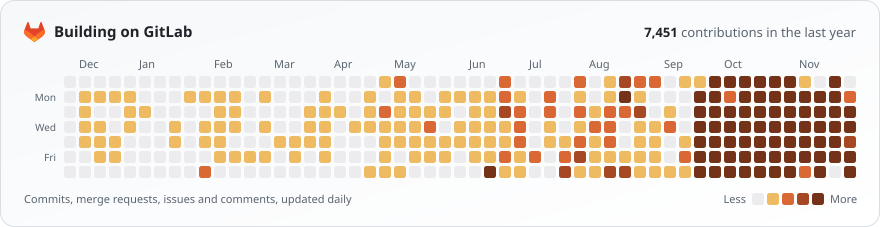
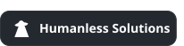

<picture>
  <source media="(prefers-color-scheme: dark)" srcset="./banner-dark.svg">
  
</picture>

### Hey there 👋

For eight years I ran a web studio and shipped 50+ ERP, CRM, and internal systems. Every time, decisions got buried in chats and nothing moved unless you kept nudging everyone

Today I'm building [Space](https://humanless.space/), a workspace where your team and AI agents work side by side. Calls and chats turn into tasks and knowledge base updates on their own. The agents learn from your edits and need less of your attention over time

Right now I'm focused on voice and text agents and how they share memory across a team

### Coding activity

<a href="https://gitlab.com/GoGennady">
<picture>
  <source media="(prefers-color-scheme: dark)" srcset="https://raw.githubusercontent.com/GoGennady/GoGennady/activity/activity-dark.svg">
  
</picture>
</a>

### Let's talk

[Try Space](https://humanless.space/) or [message me](https://www.linkedin.com/in/gogennady) if you want to talk agents, product, or a technical partnership

